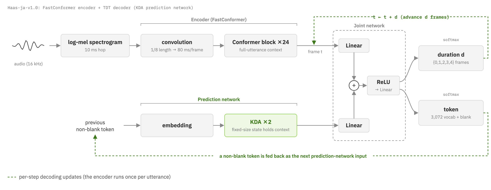
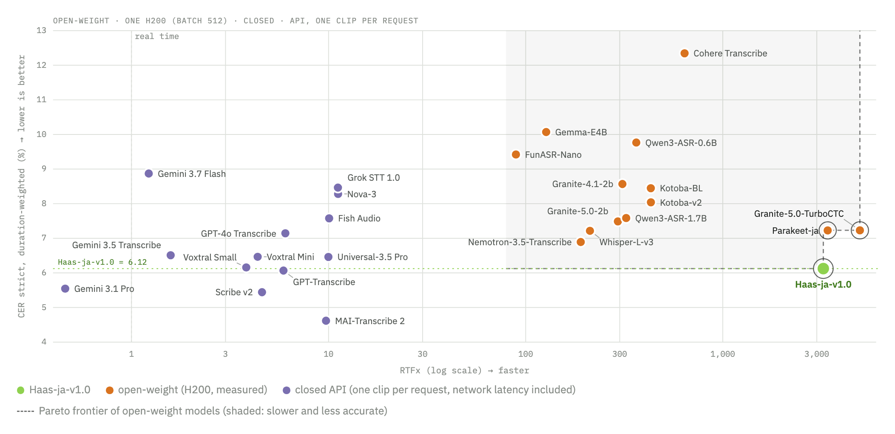
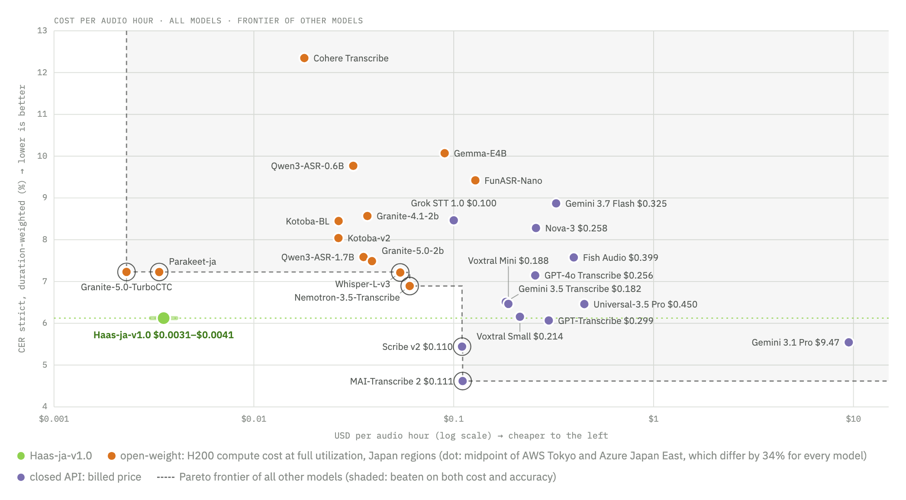

# Haas-ASR

<p align="center">
  🤗 <a href="https://huggingface.co/third-intelligence/Haas-ja-v1.0">Model</a>&nbsp;&nbsp;|&nbsp;&nbsp;📑 <a href="TODO-blog-url">Blog</a>&nbsp;&nbsp;|&nbsp;&nbsp;📊 <a href="https://huggingface.co/datasets/third-intelligence/asr-ja-bench">Benchmark</a>&nbsp;&nbsp;|&nbsp;&nbsp;📏 <a href="https://github.com/third-intelligence/jacer">jacer</a>
</p>

Inference code for the **Haas** speech recognition models. The first release,
**Haas-ja-v1.0**, is a Japanese model: a FastConformer encoder with a TDT
decoder whose prediction network uses Kimi Delta Attention.



## Results

On [asr-ja-bench](https://huggingface.co/datasets/third-intelligence/asr-ja-bench)
v1.1, five public Japanese test sets, Haas-ja-v1.0 reaches a weighted CER strict of
6.12%, the best of the open models we evaluated. It is competitive with commercial
APIs: on par with GPT-Transcribe (6.07%), while MAI-Transcribe 2, Scribe v2 and
Gemini 3.1 Pro remain more accurate.

In each cell, the top value is CER strict and the bottom values are CER flex / kana
(%, lower is better):


Among open models, Haas-ja-v1.0 is on the Pareto frontier of speed and accuracy. It
runs at almost the same speed as Parakeet (RTFx 3,236 vs. 3,407) while cutting CER
strict by about 1.1 points, and is about 10–15 times faster than Whisper large-v3 and
Qwen3-ASR 1.7B, the next most accurate open models.



It transcribes an hour of audio for about $0.003–0.004, roughly 1/70–1/100 of
GPT-Transcribe, which has similar accuracy.



For the evaluation details, including the benchmark design, the CER metrics and the
full results, see the [blog post](TODO-blog-url). [Evaluation](#evaluation) below
shows how to reproduce the Haas-ja-v1.0 results.

## Requirements

- Linux with an NVIDIA GPU. The decoder's attention kernels come from
  [flash-linear-attention](https://github.com/fla-org/flash-linear-attention),
  which needs Triton and CUDA, so CPU and macOS are not supported.
- Python 3.10+, NeMo 2.7.
- The speaker-label example has its own environment, with Python 3.12 and a newer NeMo.
  It is created in `examples/speakers/` the first time you run the example and leaves
  the default environment unchanged.

## Install

**Try it with this repository**

Clone it and install with
[uv](https://docs.astral.sh/uv/), which uses the exact dependency versions in
`uv.lock`, the ones we test with:

```bash
git clone https://github.com/third-intelligence/Haas-ASR.git
cd Haas-ASR
uv sync
uv run python examples/quickstart.py --model third-intelligence/Haas-ja-v1.0 example.wav
```

**Use it in your own project**

Install the package into your environment:

```bash
pip install "haas-asr @ git+https://github.com/third-intelligence/Haas-ASR.git"
```

This resolves dependencies within the ranges in `pyproject.toml` rather than the
locked versions.

## Quickstart

```python
import haas_asr

model = haas_asr.load_model("third-intelligence/Haas-ja-v1.0")
audio = haas_asr.load_audio("example.wav")
output = model.transcribe([audio])
print(output[0].text)
```

`load_audio` reads a WAV, FLAC, MP3 or OGG file, averages stereo to mono and
resamples it to 16 kHz, the model's input. `load_model` returns a regular NeMo
`ASRModel`, so everything in NeMo's ASR API works on it. To use
`ASRModel.from_pretrained` yourself, `import haas_asr` first so that NeMo can build
the custom decoder.

## Long-form audio

The model was trained on utterances of up to 30 s. For longer audio, it cuts at
quiet points and transcribes the chunks in batches:

```python
audio = haas_asr.load_audio("example.flac")
text = haas_asr.transcribe_longform(model, audio, batch_size=64)
```

See [`examples/`](examples/) for runnable scripts.

## Custom vocabulary

Names and terms the model rarely heard in training can be listed, so that it
recognises them more often and writes them as you want:

```python
vocabulary = haas_asr.Vocabulary(
    {"Haas": ["ハース"], "Third Intelligence": ["サードインテリジェンス"]}
)
texts = haas_asr.transcribe(model, [audio], vocabulary=vocabulary)  # short clips
text = haas_asr.transcribe_longform(model, audio, vocabulary=vocabulary)
```

Each word maps its written form to its readings, the ways Haas would write it (usually
in kana; several, or none if Haas already writes it as listed). The readings are
boosted while decoding with NeMo's
[GPU phrase boosting](https://docs.nvidia.com/nemo-framework/user-guide/latest/nemotoolkit/asr/asr_customization/word_boosting.html),
and replaced by the written form wherever found, whether in hiragana or katakana,
full-width or not, in any letter case or spacing.

Boosting can also change text where no listed word was said. To prevent most of this,
audio without speech is not boosted, and each audio is also decoded without the words:
a change is kept only where it includes a whole listed word. Both decodes share one
encoder pass, so a vocabulary costs about 1.3 times the time. This check cannot tell
when boosting writes a whole listed word where it was not said, and each listed word
adds a small chance of that, so list only the words you need.

```bash
# --words "written form=reading,reading"
uv run python examples/transcribe_with_vocabulary.py --model third-intelligence/Haas-ja-v1.0 \
    example.flac --words "Haas=ハース,ハウス" "Third Intelligence=サードインテリジェンス"
```

## Speaker labels, with Nemotron-3-Diarization

Haas can be combined with other models. With NVIDIA's speaker diarization model
[Nemotron-3-Diarization](https://huggingface.co/nvidia/Nemotron-3-Diarization), which
finds who speaks when, it produces a transcript with speaker labels:

```bash
uv run --project examples/speakers python examples/speakers/transcribe_with_speakers.py example.wav
```

```
[00:00:00.8] Speaker 1: 本日はよろしくお願いします
[00:00:03.1] Speaker 2: こちらこそ、よろしくお願いします
```

The diarization model needs a newer NeMo than this package pins, so the example has
its own environment in [`examples/speakers/`](examples/speakers/), created the first
time you run it. The default environment is unchanged. `--words` adds a custom
vocabulary. Speakers are numbered in order of appearance; overlapping speech is
transcribed in each speaker's turn.

## Evaluation

The model card's results are measured on
[asr-ja-bench](https://huggingface.co/datasets/third-intelligence/asr-ja-bench) v1.1.
The dataset repository ships no audio or transcripts, only the sample lists and a
`rebuild.py` script, so the benchmark is built locally first:

1. Download the dataset repository and the upstream corpora, as its card describes.
2. Run its `rebuild.py`. It writes the **benchmark data directory**
   (`asr-ja-bench-v1.1/` in the card's example): one `<subset>.jsonl` per subset,
   listing each sample's audio path and transcript, and the audio under `audio/`.
3. Evaluate, with `--bench` pointing at that benchmark data directory (not at the
   downloaded dataset repository):

```bash
uv sync --group eval
uv run python examples/evaluate_asr_ja_bench.py \
    --model third-intelligence/Haas-ja-v1.0 --bench path/to/asr-ja-bench-v1.1
```

The dataset repository, the benchmark data directory and this repository can live
anywhere; `--bench` is the only link between them.

This prints CER strict, flex and kana for each subset and the duration-weighted
overall score, scored with [jacer](https://github.com/third-intelligence/jacer).
`--out <dir>` also writes every hypothesis.

## Demos

Two browser demos run on your own GPU: long-form transcription of an uploaded
recording, and real-time captions from the microphone.

```bash
uv sync --group demo
uv run python -m demos.app      # then open http://localhost:7860
```

See [`demos/README.md`](demos/README.md) for options and how the real-time demo works.
These are simple versions to run locally; the
[Hugging Face Space](https://huggingface.co/spaces/third-intelligence/Haas-ja-v1.0) also
has the custom vocabulary and speaker labels.

## Acknowledgements

Haas-ja-v1.0 stands on the work of many people, and we are grateful to all of them.
It builds on [NVIDIA NeMo](https://github.com/NVIDIA/NeMo) and the
[Parakeet-TDT](https://huggingface.co/nvidia/parakeet-tdt-0.6b-v2) architecture: a
[FastConformer](https://arxiv.org/abs/2305.05084) encoder with a
[Token-and-Duration Transducer](https://arxiv.org/abs/2304.06795) decoder. Its
prediction network uses Kimi Delta Attention from
[Kimi Linear](https://arxiv.org/abs/2510.26692), run on the kernels of
[flash-linear-attention](https://github.com/fla-org/flash-linear-attention), and it was
trained with [Lhotse](https://github.com/lhotse-speech/lhotse). The speaker-label
example uses NVIDIA's
[Nemotron-3-Diarization](https://huggingface.co/nvidia/Nemotron-3-Diarization)
(OpenMDW-1.1). We thank the authors of these projects for making them openly available.

We also thank the creators of [ReazonSpeech](https://huggingface.co/datasets/reazon-research/reazonspeech),
[Common Voice](https://commonvoice.mozilla.org) and
[YODAS](https://huggingface.co/datasets/espnet/yodas), whose openly released speech
made training possible, and the authors of JSUT, JVNV, TEDxJP-10K, FLEURS and
SpeechBSD, whose test sets make up our benchmark.

## License

The code in this repository is released under the [Apache 2.0 License](LICENSE), as
are the Haas-ja-v1.0 model weights. Third-party components retain their respective
licenses.
